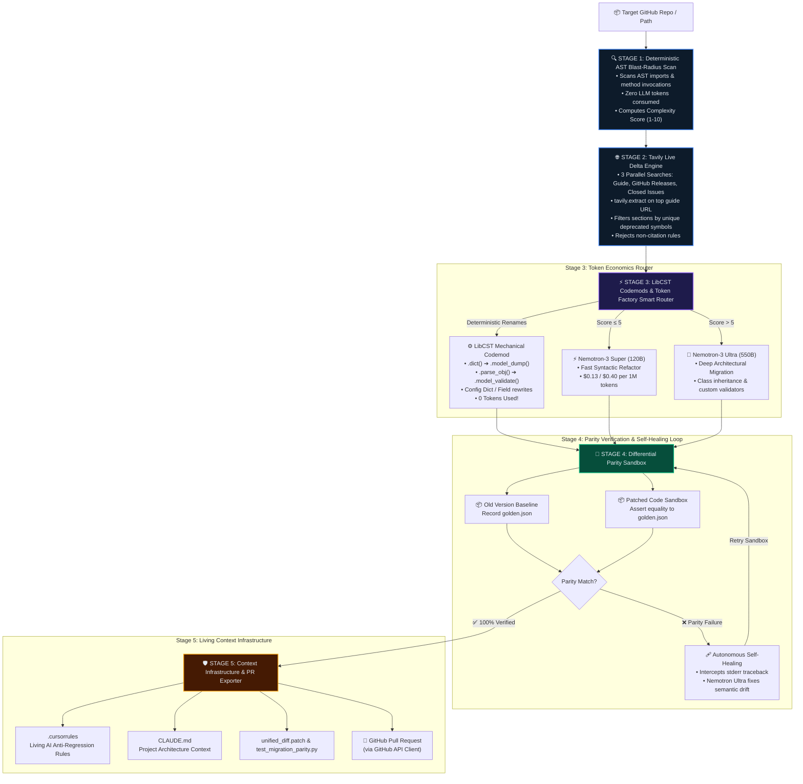

<div align="center">

# ⚡ DriftZero
### Autonomous Breaking-Change Migration Engine Powered by NVIDIA Nemotron & Nebius Token Factory

[](https://opensource.org/licenses/MIT)
[](https://nebius.com)
[](https://build.nvidia.com)
[](https://tavily.com)
[](https://nextjs.org)
[](https://fastapi.tiangolo.com)
[](https://docker.com)

**Zero-touch autonomous dependency migrations with deterministic AST blast-radius mapping, Tavily live documentation grounding, LibCST mechanical codemods, differential containerized parity testing, and living context rule generation.**

[Explore Architecture](#-architecture) • [Token Economics](#-token-economics--smart-router) • [5-Stage Pipeline](#-the-5-stage-autonomous-pipeline) • [Quickstart Guide](#-quickstart--judge-demo)

</div>

---

## 📌 The Problem

Breaking changes in foundational Python libraries (e.g. **Pydantic v1 → v2**, LangChain 0.1 → 0.2, SQLAlchemy 1.4 → 2.0) paralyze engineering teams. Upgrading manually introduces **subtle semantic drift**, broken validation lifecycles, and silent runtime regressions. 

Generic AI code assistants fail at ecosystem migrations because:
1. **Pre-training Weight Contamination**: Outdated models generate legacy syntax they learned during pre-training.
2. **Prohibitive LLM Cost**: Sending entire multi-thousand-line repos to 70B+ reasoning models costs hundreds of dollars per repo.
3. **Silent Semantic Regressions**: Code compiles and passes basic unit tests, but subtle data transformations drift silently at runtime.

---

## 🚀 The DriftZero Solution

**DriftZero** is an autonomous breaking-change migration engine designed for production repositories:
- **Autonomous Discovery**: Automatically discovers legacy dependencies and target versions directly from `pyproject.toml`, `requirements.txt`, and AST import trees.
- **LibCST Mechanical Codemods (0 Tokens)**: Deterministically upgrades pure syntactic renames before calling any LLM.
- **Nebius Token Factory Smart Router**: Calculates AST complexity scores (1–10) and routes simple code to fast, cost-effective models (**Nemotron-3 Super**, $0.13/$0.40 per 1M) and reserves deep structural refactoring for reasoning engines (**Nemotron-3 Ultra**, $0.60/$1.80 per 1M), achieving **60% to 100% token cost savings**.
- **Tavily Live Grounding**: Runs 3-way parallel searches (migration guides, GitHub release notes, closed breaking issues) and targets sections matching detected deprecated symbols via `tavily.extract`.
- **Differential Parity Sandboxing**: Spawns old-version baseline and new-version patched containers in parallel, generates golden input/output vectors in `golden.json`, and strictly validates functional parity.
- **Autonomous Self-Healing**: Captures container stderr tracebacks on parity failure, synthesizes surgical fixes, and re-runs until parity is verified.
- **Living Context Infrastructure**: Exports `.cursorrules` and `CLAUDE.md` to prevent AI coding assistants in Cursor or Claude Code from re-introducing deprecated syntax in future development.

---

## 🏛️ Architecture



---

## 💰 Token Economics & Smart Router

DriftZero uses a deterministic AST complexity formula to route files to the exact tier required:

$$\text{Complexity Score} = (\text{AST Deprecations} \times 2) + (\text{Lines of Code} / 50) + (\text{Class Inheritance} \times 3)$$

| Routing Tier | Complexity Score | Engine | Nebius Input Rate | Nebius Output Rate | Typical Savings |
| :--- | :---: | :--- | :---: | :---: | :---: |
| **Mechanical Codemods** | Deterministic | **LibCST AST Engine** | **$0.00** / 1M | **$0.00** / 1M | **100.0%** |
| **Syntactic Refactor** | Score $\le 5$ | **NVIDIA Nemotron-3 Super** | **$0.13** / 1M | **$0.40** / 1M | **78.3%** |
| **Deep Reasoning** | Score $> 5$ | **NVIDIA Nemotron-3 Ultra** | **$0.60** / 1M | **$1.80** / 1M | *Baseline* |

---

## 🔬 The 5-Stage Autonomous Pipeline

### Stage 1: Deterministic AST Blast-Radius Scan
- Scans Python AST imports (`Import`, `ImportFrom`, `Call`, `Attribute`) recursively.
- Cross-references class hierarchies inheriting from library base classes.
- Detects deprecated methods (e.g. `.dict()`, `.json()`, `.copy()`, `.parse_obj()`, `.schema_json()`, `@validator`, `@root_validator`).
- Produces `BlastRadiusReport.json` in $< 50\text{ms}$ with **0 LLM tokens**.

### Stage 2: Tavily Live Documentation Delta
- Runs **3 parallel searches** via Tavily:
  1. *Migration guide* breaking changes.
  2. *GitHub release notes* with `include_domains=["github.com"]`.
  3. *Closed breaking-change issues*.
- Calls `tavily.extract` on the top guide URL and extracts **only** sections discussing the detected deprecated symbols.
- Passes extracted context to Nebius Token Factory to synthesize structured `MigrationRule` items.
- Enforces strict source validation: rules with hallucinated `source_url`s are rejected.

### Stage 3: LibCST Codemods & Nebius Token Factory Smart Router
- Partitions files:
  - **Mechanical files**: Rewritten deterministically via LibCST with unified diff generation at **0 token cost**.
  - **Residual files**: Routed to **Nemotron Super** or **Nemotron Ultra** on Nebius Token Factory.
- Validates every generated patch with `ast.parse()`; if syntax is invalid, retries once with the exact AST error.

### Stage 4: Nebius Serverless Sandbox & Parity Verification
- Spawns baseline (original pinned version) and candidate (upgraded version) containers in parallel using Docker locally or the **Nebius Serverless Jobs API**.
- Executes differential parity test suites (`test_migration_parity.py`) using golden output comparison (`golden.json`), model serialization dumps (`model_dump()`), and error message equivalence.
- Triggers autonomous self-healing if verification fails, capturing stderr and re-verifying.

### Stage 5: Context Infrastructure & GitHub PR Exporter
- Emits anti-regression rules into `.cursorrules` and `CLAUDE.md` to prevent IDE coding assistants from generating legacy syntax.
- Bumps manifest files (`requirements.txt`, `pyproject.toml`) and adds companion packages (e.g. `pydantic-settings`).
- Bundles `.cursorrules`, `CLAUDE.md`, updated manifest, `unified_diff.patch`, and `test_migration_parity.py` into a 1-click downloadable zip.
- Checks git remote permissions, forks automatically if push access is missing, and opens a GitHub Pull Request.

---

## ⚡ Quickstart & Judge Demo

### Prerequisites
- Python 3.11+
- Node.js 18+
- Docker & Docker Compose (optional, for containerized execution)
- API Keys: Nebius AI Studio and Tavily AI

### Option A: 1-Click Docker Compose (Recommended)

1. Clone the repository and configure your environment:
```bash
git clone https://github.com/shubhv123/DriftZero.git
cd DriftZero
cp .env.example .env
# Edit .env with your NEBIUS_API_KEY and TAVILY_API_KEY
```

2. Start all services:
```bash
docker compose up --build
```

3. Open your browser to `http://localhost:3000`. Click **"⚡ 1-Click Judge Demo"** on the top bar to run the full autonomous migration pipeline.

---

### Option B: Local Development Setup

#### 1. Backend Setup
```bash
# Create and activate virtual environment
python3 -m venv env
source env/bin/activate

# Install backend dependencies
pip install -r backend/requirements.txt

# Start FastAPI server
uvicorn backend.main:app --host 0.0.0.0 --port 8000 --reload
```

#### 2. Frontend Setup
```bash
cd frontend

# Install frontend dependencies
npm install

# Start Next.js development server
npm run dev
```

Visit `http://localhost:3000` to interact with the DriftZero Command Center.

---

### Option C: CLI Mode Execution

You can run the entire 5-stage pipeline directly from your terminal:

```bash
# Autonomous mode (auto-detects library & version from repo manifests)
python -m backend.main ./demo_target_repo

# Explicit mode
python -m backend.main ./demo_target_repo pydantic 2.9.2
```

---

## ⚙️ Environment Variables

| Variable | Required | Description | Default |
| :--- | :---: | :--- | :--- |
| `NEBIUS_API_KEY` | **Yes** | Nebius AI Studio Token Factory API key | — |
| `TAVILY_API_KEY` | **Yes** | Tavily AI search and extraction API key | — |
| `GITHUB_TOKEN` | Optional | GitHub Personal Access Token for PR creation | — |
| `NEBIUS_SERVERLESS_JOB_ENDPOINT`| Optional | Nebius Serverless Jobs API endpoint | Container fallback |
| `ALLOW_LOCAL_REPOS` | Optional | Security toggle allowing local workspace paths | `1` |
| `NEXT_PUBLIC_API_URL` | Optional | API base URL for the Next.js frontend | `http://localhost:8000` |

---

## 📂 Repository Structure

```
DriftZero/
├── backend/
│   ├── core/
│   │   ├── ast_scanner.py          # Stage 1: AST visitor & complexity scoring
│   │   ├── codemods.py             # Stage 3: LibCST mechanical rewrites
│   │   └── repo_manager.py         # Git workspace management & manifest bumping
│   ├── intelligence/
│   │   ├── prompts.py              # System prompts for synthesis & refactoring
│   │   ├── tavily_delta_engine.py  # Stage 2: Tavily 3-way parallel search & extract
│   │   ├── telemetry_tracker.py    # Live token economics & cost tracking
│   │   └── token_factory_router.py # Stage 3: Nebius Token Factory Smart Router
│   ├── verification/
│   │   ├── nebius_job_runner.py    # Stage 4: Nebius serverless & sandbox container runner
│   │   └── parity_test_gen.py      # Stage 4: Differential parity test generator
│   ├── exporters/
│   │   ├── github_pr_client.py     # Stage 5: GitHub API client & PR creator
│   │   └── rules_generator.py      # Stage 5: .cursorrules & CLAUDE.md compiler
│   ├── schemas/
│   │   └── migration_models.py     # Pydantic & Dataclass domain models
│   ├── Dockerfile                  # Production FastAPI container image
│   ├── main.py                     # FastAPI SSE streaming server & CLI entrypoint
│   └── requirements.txt            # Python dependencies
├── frontend/
│   ├── src/
│   │   ├── app/page.tsx            # Main Command Center UI & SSE stream listener
│   │   ├── components/             # React visualizer components
│   │   │   ├── BlastRadiusTree.tsx # Interactive AST blast-radius file tree
│   │   │   ├── ContextRulesExportTab.tsx # .cursorrules/CLAUDE.md viewer & zip exporter
│   │   │   ├── DiffViewerTab.tsx   # Side-by-side Monaco diff visualizer
│   │   │   ├── PipelineStepper.tsx # Real-time 5-stage progress indicator
│   │   │   ├── SandboxTerminalTab.tsx # Nebius sandbox log & self-healing terminal
│   │   │   ├── TelemetryBar.tsx    # Token economics & Nebius rates visualizer
│   │   │   └── TopControlBar.tsx   # Repo input, target version & build log drawer
│   │   └── types/migration.ts      # TypeScript interfaces
│   ├── Dockerfile                  # Next.js production container image
│   └── package.json                # Frontend dependencies
├── sandbox_runner/
│   ├── Dockerfile.sandbox          # Dual-container parity verification image
│   └── entrypoint.sh               # Container test execution harness
├── demo_target_repo/               # Pre-bundled Pydantic v1 demo codebase for testing
├── docker-compose.yml              # Complete multi-service compose orchestration
├── .env.example                    # Environment template
└── LICENSE                         # MIT License
```

---

## 🧪 Testing

Run unit and integration suites with pytest:

```bash
# Run all tests
PYTHONPATH=. pytest -v

# Run targeted subsystem verification
PYTHONPATH=. python3 -m unittest scratch/test_tavily_delta_engine_enhancements.py
PYTHONPATH=. python3 scratch/test_stage5_and_build_log.py
PYTHONPATH=. python3 scratch/test_ast_scanner_enhancements.py
```

---

## 📄 License

This project is open-source under the terms of the [MIT License](LICENSE).
